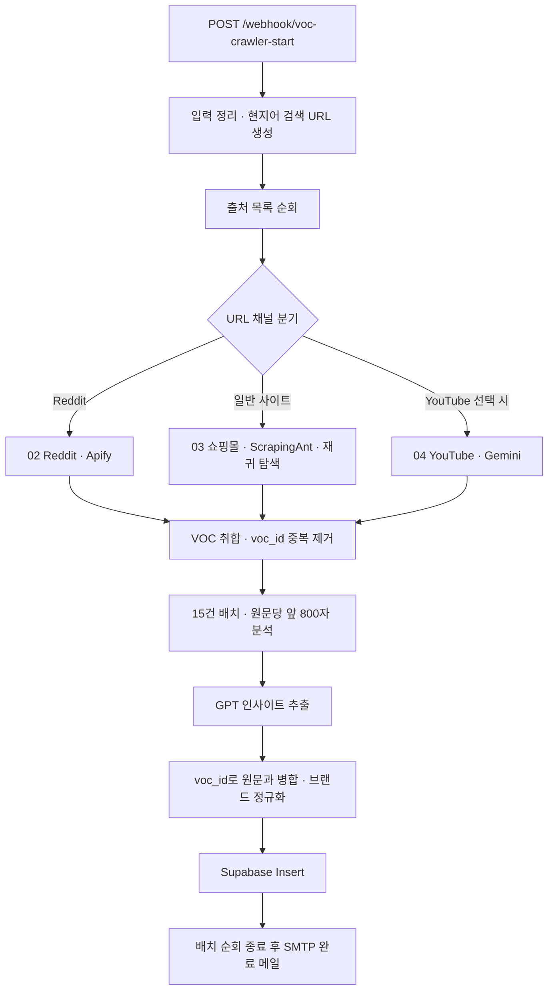
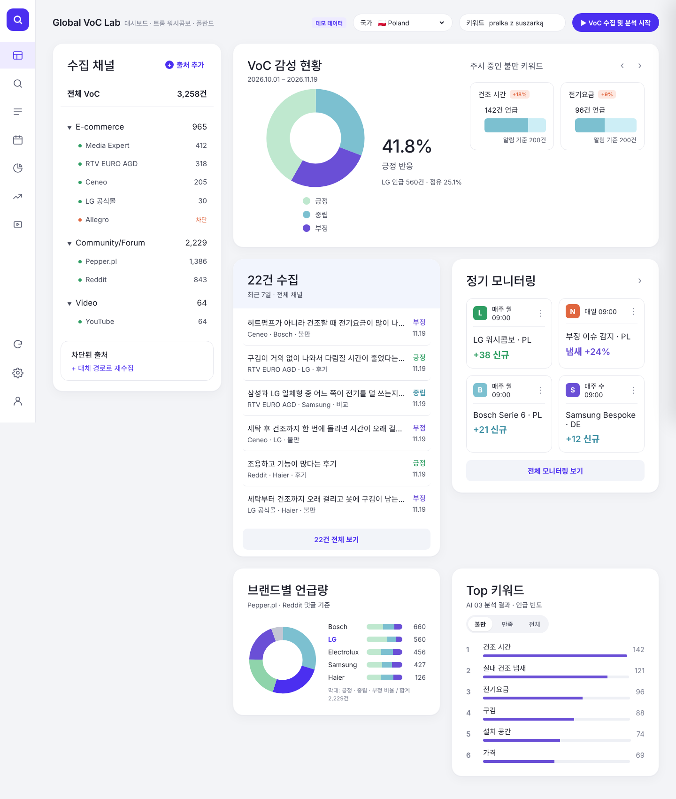
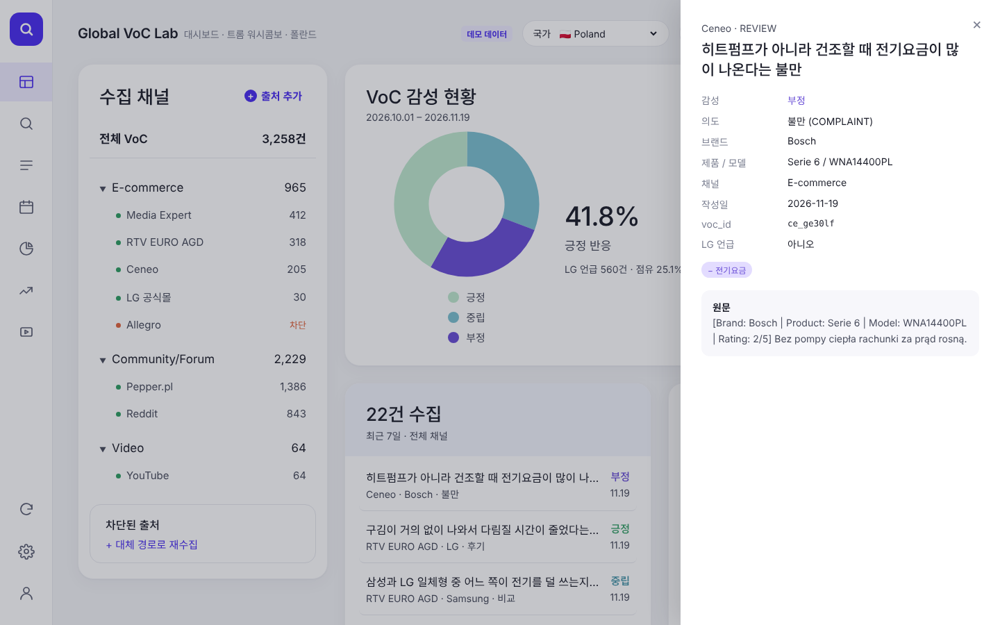
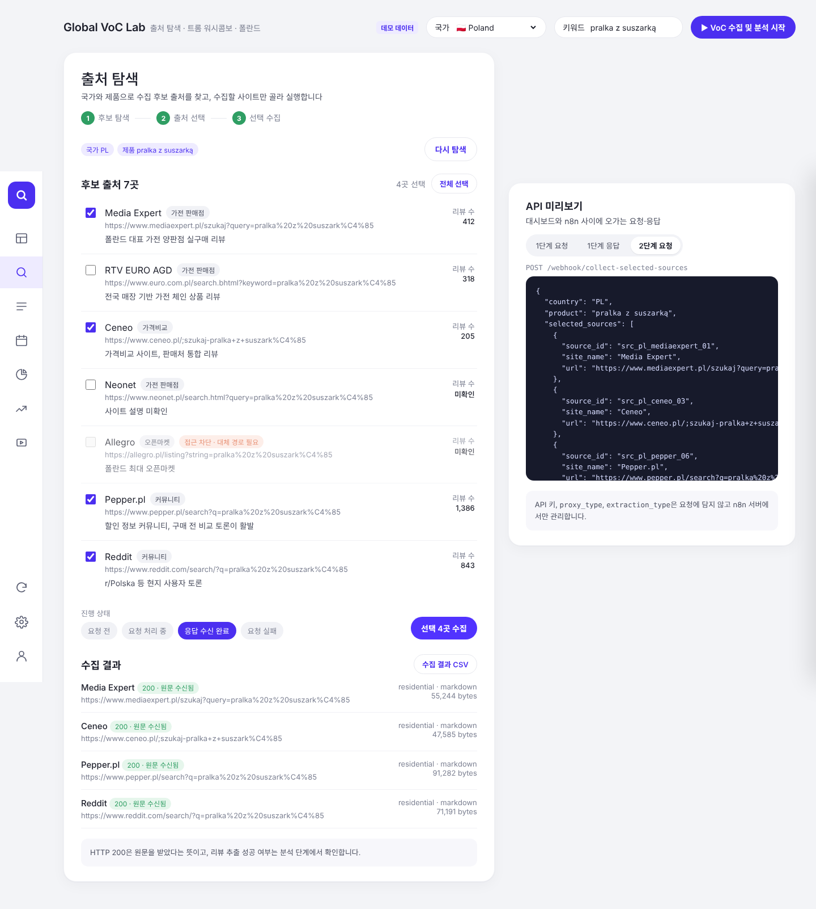
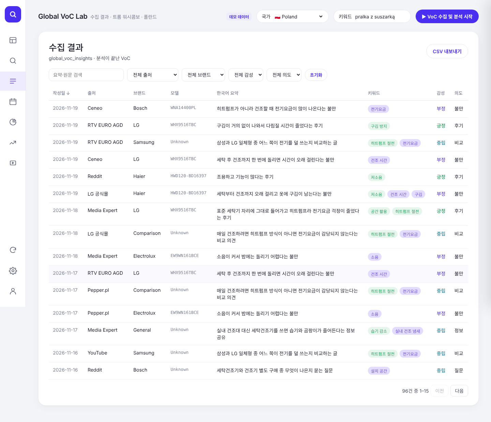
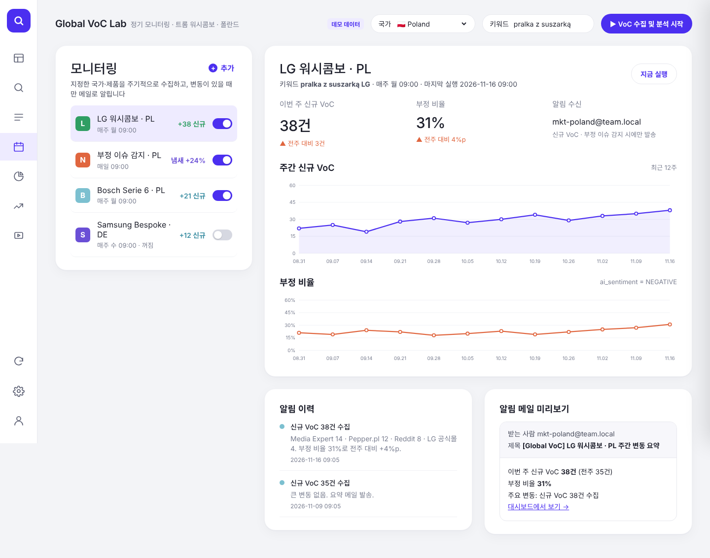
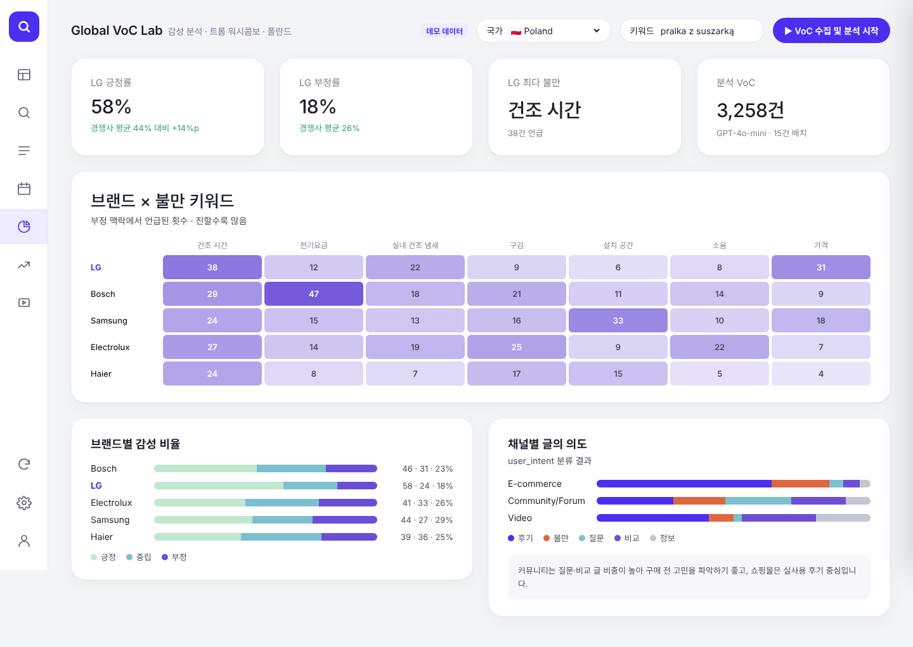
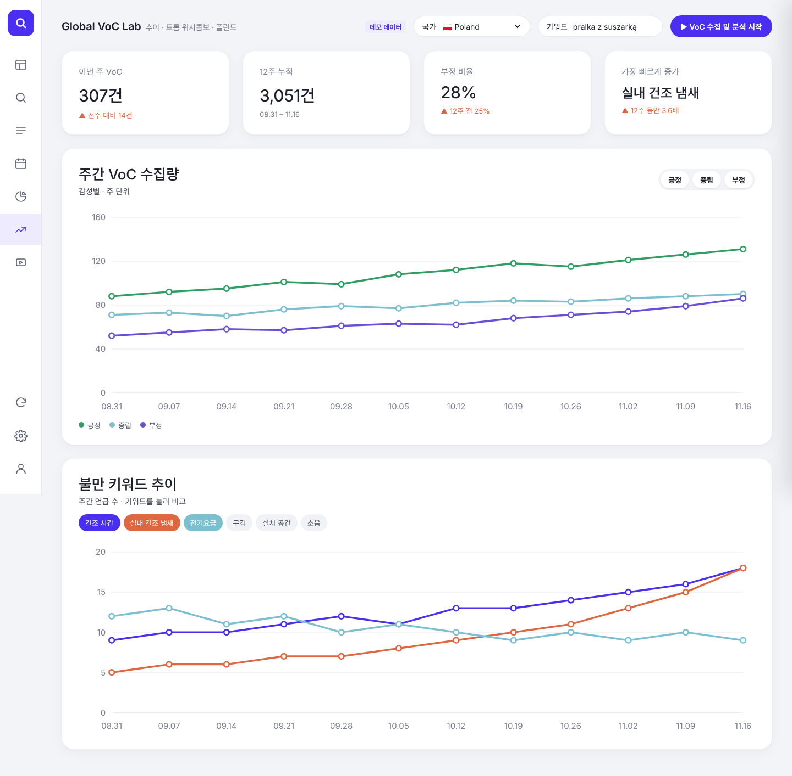
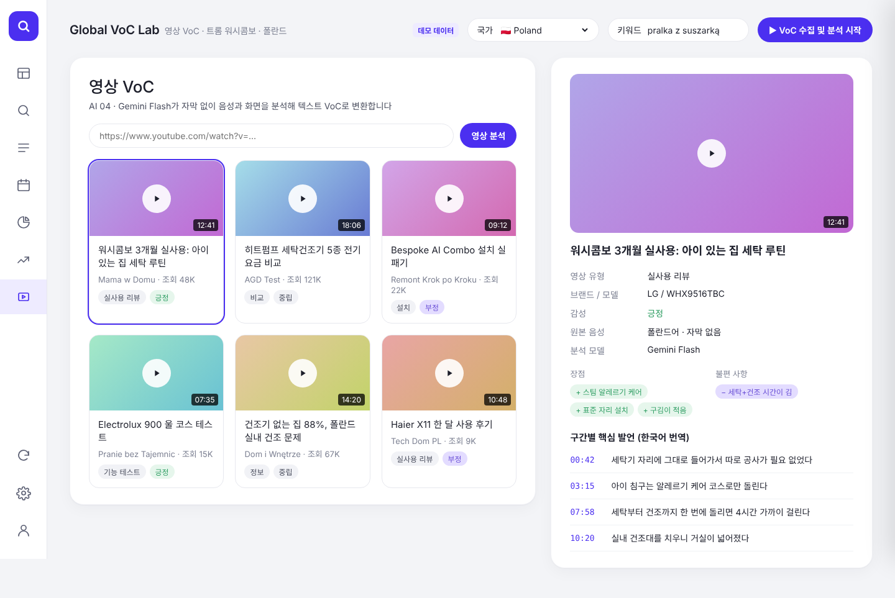

# Global VoC Research Agent

국가와 제품 키워드를 입력받아 해외 커뮤니티·쇼핑몰·YouTube에서 VOC를 수집하고, 한국어 비즈니스 인사이트로 정규화해 Supabase에 저장하는 **n8n 기반 수집·분석 파이프라인**입니다.

배포 기준은 [`workflows/n8n`](workflows/n8n)의 4개 JSON입니다. 각 파일은 독립된 n8n 워크플로우이며, 마스터 컨트롤러가 채널별 수집기를 호출합니다. 워크플로우의 Code 노드가 실행 로직의 원본입니다.

## 1. 구성과 기술 스택

| 계층 | 구성 | 역할 |
| --- | --- | --- |
| 오케스트레이션 | n8n Webhook / Execute Workflow / Loop Over Items | 입력 정리, 채널 분기, 하위 워크플로우 실행, 분석 배치 순회 |
| 커뮤니티 수집 | Apify `trudax~reddit-scraper-lite` | Reddit 본문과 댓글 수집 |
| 쇼핑몰 수집 | ScrapingAnt Markdown API | 브라우저 렌더링과 국가별 프록시를 이용한 페이지 수집 |
| 텍스트 분석 | OpenAI `gpt-4o-mini` | 현지어 검색 URL 생성, 페이지 판정, 리뷰 추출, VOC 인사이트 분석 |
| 영상 분석 | Gemini `generateContent` API | YouTube URL을 전달해 영상·음성 기반 VOC 생성 |
| 저장 | Supabase / PostgreSQL | `global_voc_insights`에 최종 VOC Insert |
| 실행 환경 | Docker Compose | n8n 실행과 워크플로우·Credentials·실행 이력 영속화 |

모델명과 API 경로는 JSON에 기록된 설정을 설명합니다. YouTube 수집기의 현재 모델 경로는 `gemini-3.8-flash:generateContent`이며, 사용 계정에서의 모델 제공 여부와 YouTube URL 지원은 실행 전에 확인해야 합니다. 검증된 n8n 버전 정보는 원본에 포함되어 있지 않습니다.

## 2. 저장소 구조

```text
.
├── workflows/
│   └── n8n/
│       ├── 01-master-controller.json       # Webhook → 수집 → AI 분석 → DB → 완료 메일
│       ├── 02-reddit-collector.json        # Reddit 게시글·댓글 정규화
│       ├── 03-recursive-web-crawler.json   # 쇼핑몰 탐색·리뷰 추출·재귀 호출
│       └── 04-youtube-collector.json       # 영상 검색·Gemini 분석·VOC 변환
├── infra/
│   └── n8n/
│       ├── docker-compose.yml             # n8n 컨테이너와 영속 볼륨
│       └── .env.example                   # n8n 암호화 키 설정 예시
├── docs/
│   ├── ai-system-prompts.md               # AI 노드별 역할·입출력·작성 규칙
│   ├── repository-layout.md               # 이전 경로와 새 경로, 정리 범위
│   └── images/                            # 기존 대시보드 화면·데모 자료
├── tools/
│   └── validate-workflows.mjs             # JSON·연결·Code 노드 문법 정적 검사
├── global-voc-agent/                      # 기존 대시보드·서버·연동 문서 보존
├── .gitattributes
├── .gitignore
└── README.md
```

`global-voc-agent/`와 대시보드 이미지의 기존 경로를 유지합니다. 이 폴더 안의 `global_voc_scraper_workflow.json`은 기존 대시보드 문서가 참조하는 레거시 자료이며, 신규 수집 파이프라인의 import 대상은 `workflows/n8n/`입니다.

## 3. 처리 아키텍처



### 3.1 마스터 컨트롤러

1. 입력의 `body` 또는 최상위 객체에서 `country`, `keyword`, `include_youtube`를 읽습니다.
2. LLM이 국가 코드, 현지어 키워드와 출처별 검색 URL을 생성합니다. 프롬프트는 서로 다른 쇼핑몰 도메인 5개 이상과 Reddit 1개를 요청합니다. 실제 개수나 URL 유효성을 보장하는 검증 단계는 없습니다.
3. `include_youtube`가 `true` 또는 문자열 `"true"`이면 YouTube 검색 URL을 추가합니다.
4. URL 문자열에 `reddit.com`이 있으면 Reddit, `youtube.com`이 있으면 YouTube, 그 외에는 쇼핑몰 수집기로 전달합니다.
5. `voc_id`와 `content`가 있는 결과를 취합하고, 같은 `voc_id`는 Map으로 합칩니다. 크롤링 로그 행은 분석 대상에서 제외합니다.
6. 최대 15건씩 분석합니다. AI 입력에는 원문 앞 800자만 전달하고, DB 저장에는 원문 전체를 사용합니다.
7. AI 결과를 `voc_id`로 결합하고 브랜드 표기와 경쟁사 목록을 정규화한 뒤 DB에 저장합니다.

### 3.2 Reddit 수집기

Apify Actor를 동기 호출하고 중첩 댓글·개별 댓글을 공통 스키마로 변환합니다. 요청 설정은 `maxItems=30`, `maxPostCount=5`, `maxComments=15`, `sort=relevance`, `time=all`이며 HTTP 타임아웃은 180초입니다. 실제 반환량은 Actor 동작과 검색 결과에 따라 달라집니다.

게시글은 `RD_POST_<id>`, 댓글은 `RD_CMT_<id>`로 식별합니다. 삭제·제거된 댓글을 제외하고 작성일은 가능한 경우 `YYYY-MM-DD`로 정규화합니다. 검색에는 현지어 키워드를 사용하며 국가별 게시글만 선별하는 별도 필터는 없습니다.

### 3.3 쇼핑몰 재귀 크롤러

ScrapingAnt에서 받은 Markdown을 정리하고 링크 후보를 코드로 추출해 번호를 매깁니다. LLM은 페이지를 `PRODUCT`, `LIST`, `IRRELEVANT`로 판정하고 리뷰와 후속 링크를 반환합니다. 상품 설명과 실제 소비자 리뷰를 구분하도록 프롬프트를 구성했습니다.

| 제어 항목 | MODEL 모드 | CATEGORY 모드 |
| --- | --- | --- |
| 모드 선택 | 영문·숫자가 섞인 5자 이상 모델 토큰 감지 | 그 외 제품군 키워드 |
| 재귀 깊이 | `depth > 6`이면 종료 | 동일 |
| 단계당 입력 페이지 상한 | 10 | 20 |
| 목록 페이지의 후속 링크 상한 | 3 | 10 |
| 상품 페이지의 후속 리뷰 링크 상한 | 3 | 1 |
| 후속 리뷰 탐색 중단 기준 | `review_hops > 5` | `review_hops > 2` |

방문 이력과 기준 도메인 접미사 검사로 탐색 범위를 줄입니다. 링크 후보는 최대 200개, AI에 전달하는 정리 본문은 약 30,000자로 제한합니다. ScrapingAnt는 `browser=true`, `proxy_type=residential`, 60초 타임아웃, 요청 배치 크기 2를 사용하며 `UK`는 프록시 국가 `GB`로 변환합니다.

차단·수집 실패 시 같은 URL을 최대 2회 추가 시도할 수 있습니다. 대체 URL이 전달되면 실패 유형에 따라 대체 경로를 사용하지만, 현재 마스터는 `fallback_urls: []`를 전달하므로 홈페이지·검색엔진 대체 경로가 자동 생성되지는 않습니다. 실행 결과에는 리뷰 외에 `_crawl_log` 진단 행도 포함됩니다.

### 3.4 YouTube 수집기

검색 URL에 4분 미만 필터를 추가하고 HTML에서 `videoId`를 추출해 중복 제거 후 최대 5개를 분석합니다. Gemini 요청의 타임아웃은 300초이며, 분석 텍스트가 20자 이하인 응답은 제외합니다. 결과는 `YT_<video_id>` / `content_type=VIDEO`로 변환한 뒤 공통 AI 분석 단계로 전달합니다.

검색 필터에 의존하므로 영상 길이를 별도로 검증하지 않습니다. 이 수집기의 `published_at`은 실제 영상 게시일이 아니라 분석 시각입니다.

## 4. 입력과 저장 데이터 계약

### 4.1 수집 진입점

```http
POST /webhook/voc-crawler-start
Content-Type: application/json
```

```json
{
  "country": "PL",
  "keyword": "세탁건조기",
  "include_youtube": false
}
```

| 필드 | 처리 방식 |
| --- | --- |
| `country` | 미입력 시 `US`. 일관된 처리를 위해 2자리 국가 코드 사용 |
| `keyword` | 미입력 시 빈 문자열. 실행 전에 호출 측에서 유효한 검색어 확인 |
| `include_youtube` | 불리언 `true` 또는 문자열 `"true"`일 때만 영상 수집 추가. 기본 `false` |

Webhook은 `responseMode=lastNode`인 동기 처리입니다. 고정된 응답 JSON이나 작업 ID를 반환하는 계약, 진행률 조회 API, CSV 응답은 이 4개 워크플로우에 정의되어 있지 않습니다. HTTP 호출자는 전체 수집·분석 시간과 프록시 타임아웃을 함께 고려해야 합니다.

### 4.2 최종 저장 대상: `global_voc_insights`

다음은 최종 병합 노드가 생성하는 필드입니다. 테이블 생성 SQL이나 DB 마이그레이션은 포함하지 않으며, 아래 타입은 워크플로우 출력에 대응하는 구성 예시입니다.

| 필드 | 출력 값 / 대응 타입 예시 | 의미 |
| --- | --- | --- |
| `voc_id` | 문자열 / `text` | 출처별 식별자 |
| `country`, `keyword` | 문자열 / `text` | 호출자가 입력한 국가·원래 검색어 |
| `source_site`, `category` | 문자열 / `text` | 사이트명과 채널 유형 |
| `content_type` | `POST`, `COMMENT`, `REVIEW`, `VIDEO` / `text` | 원문 유형 |
| `content` | 문자열 / `text` | 수집 원문 또는 영상 분석 텍스트 |
| `parent_id` | 문자열 또는 `null` / `text` | Reddit 상위 글 식별자 또는 쇼핑몰·영상 URL |
| `published_at` | 날짜·시각 문자열 또는 `null` | 원문 날짜. 채널별 정밀도와 의미가 다름 |
| `product_category`, `target_brand` | 문자열 / `text` | 제품군·평가 대상 브랜드 |
| `product_line`, `model_code` | 문자열 / `text` | 제품 라인·모델명 |
| `positive_keywords`, `negative_keywords` | 문자열 배열 / `text[]` | 대상 브랜드의 긍정·부정 키워드 |
| `topic_tags`, `competitors` | 문자열 배열 / `text[]` | 주제와 함께 언급된 다른 브랜드 |
| `kr_summary` | 문자열 / `text` | 한국어 요약 |
| `ai_sentiment`, `user_intent` | 문자열 / `text` | 감성·발화 의도 |
| `ai_metadata` | 객체 / `jsonb` | `lg_mentioned`, `dashboard_type`, `analyzed_at` |

브랜드·제품·모델은 상품 리뷰 말머리 값을 AI 결과보다 우선합니다. 브랜드를 확정하지 못하면 `General`, 모델을 알 수 없으면 `Unknown`을 사용합니다. AI JSON 파싱 실패 시에도 원문과 기본값을 병합하며, 요약에는 실패 안내 문구가 들어갑니다.

`ai_metadata.dashboard_type`은 다음 기준으로 정합니다.

- `PRODUCT_REVIEW`: 브랜드가 `General`이 아니고 긍정·부정 키워드가 하나 이상 있음.
- `LIFE_PAINPOINT`: 위 조건에 해당하지 않으면서 의도가 `PAINPOINT`이거나, 브랜드가 `General`이고 부정 키워드가 있음.
- `MARKET_TREND`: 나머지.

쇼핑몰 수집기의 `sellers`와 YouTube 수집기의 `source_url`은 최종 병합 필드에 포함되지 않습니다. 원문 URL은 쇼핑몰·영상의 경우 `parent_id`로 남습니다.

## 5. 실행과 환경 구성

### 5.1 n8n 실행

Docker와 Docker Compose가 설치된 환경에서 실행합니다.

```powershell
cd infra/n8n
Copy-Item .env.example .env
# .env의 N8N_ENCRYPTION_KEY를 충분히 긴 임의 문자열로 설정
docker compose up -d
```

`http://localhost:5678`에서 n8n에 접속합니다. Compose는 `Asia/Seoul` 시간대, `WEBHOOK_URL=http://localhost:5678/`, `n8n_data` 영속 볼륨을 사용합니다. 외부 배포 시 실제 Webhook 도메인에 맞게 설정해야 합니다. 원본 Compose의 이미지는 `n8nio/n8n`으로 버전이 고정되어 있지 않으므로, 운영 환경에서는 import 검증을 마친 버전 태그를 고정해 사용합니다.

### 5.2 워크플로우 import 및 연결

1. n8n의 **Import from File**로 `02`, `03`, `04` 수집기를 먼저 가져옵니다.
2. `01-master-controller.json`을 가져옵니다.
3. 마스터의 Execute Workflow 노드 3개에서 해당 인스턴스의 수집기를 다시 선택합니다. JSON의 `REPLACE_WITH_*_WORKFLOW_ID`는 연결 전 표시자입니다.
4. 쇼핑몰 수집기의 자기 호출은 `={{ $workflow.id }}`를 사용합니다. 하위 워크플로우 호출 권한도 실행 계정에 맞게 확인합니다.
5. 아래 Credentials를 각 노드에 연결합니다.
6. SMTP 노드의 `sender@example.com`, `recipient@example.com`을 운영 주소로 바꾸거나, 알림을 사용하지 않으면 해당 노드를 비활성화합니다.
7. DB 필드를 확인하고 테스트 실행을 마친 뒤 마스터를 게시·활성화합니다. 테스트 Webhook은 n8n 편집기의 테스트 수신 상태에서 사용합니다.

배포용 JSON은 비활성 상태이며 원본의 Credentials 이름·ID, 인스턴스 메타데이터, 고정 실행 데이터(`pinData`), 개인 메일 주소를 제거하거나 예시 값으로 바꿨습니다. 노드 이름·연결·Code 로직과 API 요청 설정은 최종본을 유지합니다. 이는 파일 배포 작업이며 실행 중인 n8n 설정을 변경하지 않습니다.

### 5.3 필요한 Credentials

| 대상 | n8n Credential / 인증 방식 | 적용 위치 |
| --- | --- | --- |
| OpenAI | OpenAI API (`openAiApi`) | 마스터의 Chat Model 2개, 쇼핑몰의 Chat Model 1개 |
| Apify | Query Auth (`httpQueryAuth`), 파라미터 `token` | Reddit HTTP Request |
| ScrapingAnt | Header Auth (`httpHeaderAuth`), 헤더 `x-api-key` | 쇼핑몰 HTTP Request |
| Gemini | Header Auth (`httpHeaderAuth`), 헤더 `x-goog-api-key` | YouTube Gemini HTTP Request |
| Supabase | Supabase API (`supabaseApi`) | 마스터 DB Insert |
| SMTP | SMTP (`smtp`) | 마스터 완료 메일 |

외부 API 키는 n8n Credentials에서 관리합니다. Compose의 `.env`는 n8n 암호화 키 설정용이며 외부 서비스 Credentials를 자동 생성하지 않습니다. DB의 Data API 노출 권한과 RLS는 실제 접근 주체에 맞게 설정하고, 서버 전용 비밀 키를 브라우저 코드에 넣지 않습니다. [Supabase Data API 보안 문서](https://supabase.com/docs/guides/api/securing-your-api)를 참고하세요.

### 5.4 호출 예시

```powershell
$body = @{
  country = 'PL'
  keyword = '세탁건조기'
  include_youtube = $false
} | ConvertTo-Json

Invoke-RestMethod `
  -Method Post `
  -Uri 'http://localhost:5678/webhook/voc-crawler-start' `
  -ContentType 'application/json; charset=utf-8' `
  -Body ([System.Text.Encoding]::UTF8.GetBytes($body))
```

## 6. 운영과 검증

### 6.1 오류 처리의 범위

| 상황 | 현재 동작 | 확인할 지점 |
| --- | --- | --- |
| 출처 생성 JSON 오류 | 파싱 오류를 던지고 중단 | 출처 생성 LLM 응답 |
| 하위 수집기·일부 HTTP 오류 | `continueRegularOutput`으로 다음 처리 진행 | 해당 노드의 오류 출력과 실제 VOC 건수 |
| 쇼핑몰 차단·빈 Markdown | `BLOCKED` / `SCRAPE_FAIL` 기록, 제한된 재시도 | `_crawl_log`, `retry`, `md_len`, `md_head` |
| 쇼핑몰 AI JSON 오류 | `PARSE_ERROR`로 후속 탐색 제외 | 페이지 판정 응답 |
| 인사이트 JSON 오류 | 원문을 기본값과 병합 | `kr_summary`, 빈 키워드 배열 |
| Gemini 실패·짧은 응답 | 해당 영상 VOC 제외 | Gemini 노드 출력 |
| DB Insert 오류 | 오류를 일반 출력으로 이어서 배치 순회 | DB 노드 오류와 실제 저장 행 |
| SMTP 오류 | 메일 노드에 별도 오류 지속 설정 없음 | 저장 결과와 알림 실패를 따로 확인 |

완료 메일은 배치 루프 종료 후 실행됩니다. DB 노드가 오류를 이어서 처리하므로 **메일 수신만으로 모든 행의 저장 성공을 판단할 수 없습니다.**

### 6.2 현재 구현의 한계

- 중복 제거는 수집 실행 내부의 `voc_id` Map 처리입니다. DB 저장은 Insert이며 Upsert·재실행 멱등성·요청별 트랜잭션은 구현되어 있지 않습니다.
- 원문을 800자로 잘라 AI에 전달하므로 긴 리뷰·영상 분석의 뒷부분이 인사이트에 반영되지 않을 수 있습니다.
- 출처 후보 URL은 LLM이 생성합니다. 후보 생성 자체를 실제 리뷰 존재 확인으로 해석하면 안 됩니다.
- URL 분기는 문자열 포함 검사, 크롤러 도메인 제한은 접미사 검사입니다. 임의 URL 입력에 대한 엄격한 호스트 허용 목록이나 네트워크 접근 제어를 제공하지 않습니다.
- 마스터 취합은 `$items(...)`와 루프 입력을 사용합니다. 복수 출처를 실행한 뒤 각 반복의 결과가 모두 취합됐는지 n8n 실행 이력에서 확인해야 합니다.
- 깊이·분기 수·타임아웃 제한은 있지만 전체 실행의 전역 요청 예산, 백오프, 작업 큐, 별도 상태 조회 기능은 없습니다.
- Webhook 노드에 인증과 입력 스키마 검증이 설정되어 있지 않습니다. 외부 공개 시 호출 계층에서 접근 제어와 입력 검증을 구성해야 합니다.
- 기존 대시보드의 출처 탐색·선택 수집 화면이 사용하는 API와 이 마스터의 단일 수집 Webhook은 계약이 다릅니다. 대시보드 연동 변경은 이번 정리 범위에 포함하지 않습니다.

### 6.3 정적 검사와 실행 검증

```powershell
# 저장소 루트에서 실행. 추가 npm 패키지 불필요.
node tools/validate-workflows.mjs
```

검사기는 4개 JSON의 파싱, 노드 이름·ID 중복, 연결 대상, 정적 노드 참조, Code 노드 JavaScript 문법과 배포용 메타데이터를 확인합니다. 외부 API, Credentials, n8n 표현식 평가, DB 연결과 실제 실행은 검사하지 않습니다.

실행 환경에서는 채널별 소규모 실행 후 `voc_id`, 원문, 상위 식별자, 작성일과 최종 저장 행을 확인합니다. 이어서 다중 출처·15건 초과 배치·영상 포함 옵션·차단 재시도를 확인하고, DB 실패 시 완료 메일과 저장 결과가 다를 수 있는지도 점검합니다. 이 저장소 정리 과정에서는 유료 API 호출, DB 쓰기, 메일 발송을 실행하지 않았습니다.

## 7. 대시보드

- 파일: [`global-voc-agent/dashboard/index.html`](global-voc-agent/dashboard/index.html)
  - HTML 파일 하나로 동작하고 외부 라이브러리를 쓰지 않음 (차트도 SVG로 직접 그림)
  - 화면 전환은 해시 라우팅(`#/dashboard`, `#/monitor` 등)이라 새로고침해도 보던 화면이 유지됨
  - 데이터 필드는 Supabase `global_voc_insights` 스키마와 같아서, 데모 데이터를 조회 결과로 바꾸면 그대로 연결됨

### 7.1 화면 구성

| 메뉴 | 주소 | 구성 |
|---|---|---|
| 대시보드 | `#/dashboard` | 채널별 수집 현황, 감성 요약, 주시 중인 불만 키워드, 최근 VoC, 정기 모니터링, 브랜드별 언급량, Top 키워드 |
| 출처 탐색 | `#/discover` | 후보 탐색 → 출처 선택 → 선택 수집 3단계, 진행 상태 4단계, 수집 결과 CSV, API 요청·응답 미리보기 |
| 수집 결과 | `#/results` | 전체 VoC 표, 검색·필터(출처·브랜드·감성·의도)·정렬·페이지, CSV 내보내기, 원문 상세 |
| 정기 모니터링 | `#/monitor` | 모니터링 목록(켜기·끄기·추가), 12주 신규 VoC·부정 비율 추이, 알림 이력, 알림 메일 미리보기 |
| 감성 분석 | `#/sentiment` | LG·경쟁사 비교 지표, 브랜드 × 불만 키워드 히트맵, 브랜드별 감성 비율, 채널별 글의 의도 |
| 추이 | `#/trend` | 감성별 주간 수집량, 불만 키워드 추이 비교 |
| 영상 VoC | `#/video` | 영상 목록, Gemini Flash 분석 결과(영상 유형·장점·불편 사항·구간별 핵심 발언 번역) |
| 설정 | `#/settings` | n8n Webhook 주소, 데모 모드, 저장소 설정, API 키 관리 위치 |
| 계정 | `#/account` | 외부 API별 사용량, 팀 구성 |

### 7.2 화면

| 대시보드 | VoC 상세 |
|---|---|
|  |  |
| **출처 탐색 · 선택 수집** | **수집 결과** |
|  |  |
| **정기 모니터링** | **감성 분석** |
|  |  |
| **추이** | **영상 VoC** |
|  |  |

### 7.3 표시 원칙
- 진행 상태는 `요청 전` / `요청 처리 중` / `응답 수신 완료` / `요청 실패` 4가지로만 표시 (가짜 진행률 없음)
- HTTP 200 수신을 "리뷰 추출 성공"으로 단정하지 않고 "원문 수신됨"으로 구분
- 응답에 없는 값은 추정하지 않고 `미확인`으로 표시
- 알림은 신규 VoC나 부정 이슈가 생겼을 때만 메일로 발송
- 데모 데이터로 동작하는 화면에는 `데모 데이터` 표시, 실제 호출 대신 보내는 요청 내용을 `[시뮬레이션]`으로 안내

---

## 8. ?? ??

- [AI system prompts](docs/ai-system-prompts.md)
- [Repository layout](docs/repository-layout.md)
- [n8n workflow import/export](https://docs.n8n.io/workflows/export-import/)
- [Supabase Data API security](https://supabase.com/docs/guides/api/securing-your-api)
