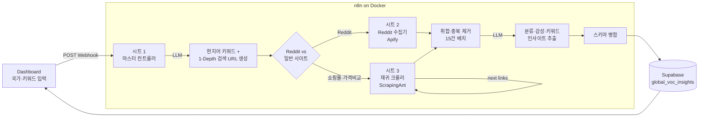

# Global VOC Agent

> 국가와 제품 키워드만 입력하면 현지 쇼핑몰·커뮤니티의 소비자 리뷰를 찾아서 수집하고, AI로 분류·요약해 DB에 쌓는 VOC 수집 에이전트
> **n8n(Docker) 워크플로우 백엔드**와 **출처 선택형 대시보드**로 구성

---

## 1. 배경

### 1.1 출발점
- LG전자 트롬 워시콤보(히트펌프 세탁건조기)의 **폴란드 런칭 전략**을 세우는 과정에서 시작
- 시장 전략의 근거로 현지 소비자의 실제 의견(VOC)이 필요했음
  - 수집 대상: 폴란드 가전 쇼핑몰, 가격비교·리뷰 사이트, 커뮤니티(Pepper.pl, Reddit), 유튜브 영상
- 그런데 분석을 시작하기도 전에, 수집 단계에서 시간과 비용이 대부분 소진됨

### 1.2 수집 과정에서 확인한 병목

| 구분 | 병목 | 실제 상황 |
|---|---|---|
| **ACCESS** | 해외 사이트 접속 제약 | 국내 IP로는 폴란드 커뮤니티와 가전 쇼핑몰 접속이 차단됨. 수집할 수 있었던 정보는 전체의 **10% 미만** |
| **LANGUAGE** | 번역과 맥락 해석 부담 | 현지어 검색어를 직접 찾아야 하고, 단순 번역으로는 현지 표현의 뉘앙스와 구매 의도를 파악하기 어려움 |
| **INTEGRATION** | 채널별 결과 분산 | 채널마다 데이터 형식이 달라 공통 기준으로 맞추고, 브랜드·제품별 비교를 위해 다시 취합하는 작업이 반복됨 |

- 기존 절차: 사이트 접속 → 개별 수집 → 번역·정리 → 분석 → 결과 통합
- 반복되는 비용: VPN 우회 비용, 번역 과정의 의미 손실, 수작업 취합

### 1.3 해결 방향

| 병목 | 해결 방식 | 구현 위치 |
|---|---|---|
| ACCESS | 대상 국가의 프록시와 헤드리스 브라우저로 접근 제한 우회 | ScrapingAnt(`proxy_country`, residential) |
| LANGUAGE | 현지어 검색어를 자동 생성하고, 수집한 원문을 한국어로 요약 | 시트 1 검색어 생성 LLM, 분석 LLM의 `kr_summary` |
| INTEGRATION | 모든 채널을 하나의 VOC 스키마로 정규화한 뒤 같은 기준으로 분류 | 시트 2·3 정규화, 시트 1 배치 분석 → Supabase |

- 목표: **국가와 제품 키워드만 입력하면** 수집부터 요약·분석·대시보드까지 하나의 흐름으로 처리
  - 예: `폴란드` + `세탁건조기` → 현지어 검색어 `pralka z suszarką` → 현지 사이트 수집 → 한국어 인사이트
- 기대 효과
  - VOC 확보 기간: 약 2주 → 약 10분
  - 국가 코드만 바꾸면 다른 거점 국가(US, DE, UK 등)로 확장 가능

### 1.4 에이전트 역할 구성

| 단계 | AI의 역할 | 사람이 하던 일 | 구현 |
|---|---|---|---|
| AI 01 · 탐색 | 현지 소비자가 쓰는 제품명으로 바꾸고, 현지 쇼핑몰·리뷰 사이트·Reddit 등 수집 대상을 구성 | 국가별 검색어를 알아보고 조사할 사이트를 직접 찾음 | 시트 1 `1-Depth 검색링크 생성` |
| AI 02 · 선별 | 페이지가 제품 상세·리뷰 / 제품 목록 / 무관한 페이지인지 판정하고, 리뷰를 추출하거나 다음 링크를 선택 | 사이트 안에서 제품 페이지와 리뷰 탭을 직접 찾아다님 | 시트 3 `AI 페이지 판정 + 추출` |
| AI 03 · 분석 | 한국어 요약, 긍·부정 키워드, 감정, 글의 의도, 브랜드·제품 정보를 공통 기준으로 정리 | 번역하고 핵심 의견을 읽어 브랜드별로 분류·비교 | 시트 1 `AI 가공` |
| AI 04 · 영상 분석 | 자막 없는 영상의 음성과 화면을 분석해 텍스트 VOC로 변환 | 현지어 영상을 직접 보고 기록·번역·요약 | 이 저장소에는 미포함 |

---

## 2. 시스템 구성



### 2.1 워크플로우 역할 분리

| 워크플로우 | 역할 | 주요 노드 |
|---|---|---|
| **시트 1** 마스터 컨트롤러 | 요청 수신 → 수집 대상 생성 → 하위 수집기 분기 호출 → 배치 분석 → DB 적재 | Webhook, LLM Chain, Switch, Execute Workflow, Split in Batches, Supabase |
| **시트 2** Reddit 수집기 | 게시글과 댓글을 한 번에 수집하고 VOC 스키마로 정규화 | HTTP Request(Apify), Code |
| **시트 3** 재귀 크롤러 | 검색 결과 → 목록 → 상품 → 리뷰 페이지를 리뷰가 나올 때까지 재귀 탐색 | HTTP Request(ScrapingAnt), LLM Chain, Execute Workflow(자기 호출) |

- 수집 채널별 하위 워크플로우를 따로 두어, 채널을 추가하거나 바꿀 때 마스터 로직을 고치지 않아도 되는 구조
- 하위 워크플로우는 모두 같은 VOC 스키마로 반환하므로 마스터 쪽에서는 채널을 구분하지 않고 취합

---

## 3. 핵심 설계

### 3.1 재귀 크롤러: 끝나는 것이 보장되는 탐색
- **종료 조건**
  - `MAX_DEPTH = 6` 비상 브레이크
  - 방문 URL 집합(`visited`)을 재귀 호출에 넘겨 같은 페이지를 다시 방문하지 않음
  - 다음 링크가 없으면 `_noop` 아이템 하나를 반환해서 재귀 호출이 바로 끝남
- **검색 모드에 따른 확장 제한**
  - 키워드에 영문+숫자 토큰이 있으면 `MODEL`(모델 하나를 깊게), 아니면 `CATEGORY`(제품군을 넓게)
  - 모드마다 페이지당 다음 링크 수, 리뷰 페이지 홉 수 상한이 다름

  | 모드 | 목록 링크 | 리뷰 링크 | 리뷰 홉 |
  |---|---|---|---|
  | MODEL | 3 | 3 | 5 |
  | CATEGORY | 10 | 1 | 2 |

- **페이지 판정**: LLM이 각 페이지를 `PRODUCT` / `LIST` / `IRRELEVANT`로 분류하고, 다음 행동(리뷰 추출 또는 하위 링크 선택)을 결정

### 3.2 LLM 환각 차단
- **링크는 코드가 뽑고 LLM은 번호만 고름**
  - 페이지의 링크를 코드로 추출하고 정규화한 뒤 번호를 붙여 LLM에 전달
  - 존재하지 않는 URL을 LLM이 지어내는 경로를 구조적으로 없앰
- **차단 페이지를 LLM에 넘기지 않음**
  - 캡차, Cloudflare 챌린지, 현지어 봇 차단 문구(폴란드어·독일어 포함)를 정규식으로 먼저 감지
  - 차단 페이지를 LLM에 주면 링크를 지어내던 문제를 실측으로 확인하고 추가한 단계
- **노이즈 링크 사전 제거**: 로그인, 장바구니, 약관, SNS, 정적 리소스 링크를 미리 걸러 LLM 입력을 줄임
- **검색 결과 페이지는 LLM 없이 처리**: DuckDuckGo 결과는 리다이렉트 파라미터(`uddg`)를 코드로 디코딩해 링크만 추출하고, 광고 링크는 제외

### 3.3 데이터 계약과 파이프라인
- **공통 VOC 스키마**: 채널과 상관없이 `voc_id`, `source_site`, `content_type`(REVIEW/POST/COMMENT), `parent_id`, `published_at` 형식으로 통일
- **중복 제거**: 원본 ID(Reddit) 또는 콘텐츠 해시(쇼핑몰 리뷰)로 만든 `voc_id`로 하위 워크플로우 결과를 합칠 때 중복 제거
- **배치 분석**: VOC를 15건 단위로 묶어 LLM에 전달해 호출 수와 토큰 비용을 줄임
- **병합 시 원본 우선**: LLM 결과는 `voc_id`로 원본에 결합하고, 분석에 실패한 항목도 기본값을 넣어 원본은 버리지 않음
- **LLM 출력 방어 파싱**: 코드블록이나 설명문이 섞인 응답에서도 JSON 배열만 추출하고, 실패하면 빈 결과로 처리해 파이프라인이 멈추지 않음

### 3.4 저장 스키마 (`global_voc_insights`)

| 구분 | 필드 |
|---|---|
| 수집 메타 | `voc_id`, `country`, `keyword`, `source_site`, `category`, `content_type`, `parent_id`, `published_at` |
| 원문 | `content` |
| 제품 4단계 계층 | `product_category` → `target_brand` → `product_line` → `model_code` |
| 키워드 3분할 | `positive_keywords`, `negative_keywords`, `topic_tags` |
| 인사이트 | `kr_summary`, `ai_sentiment`, `user_intent`(EXPERIENCE/QUESTION/COMPLAINT/COMPARISON/INFO), `competitors` |
| 분석 메타 | `ai_metadata.lg_mentioned`, `ai_metadata.analyzed_at` |

- 제품 계층과 키워드 필드는 대시보드 필터와 집계 축에 그대로 대응하도록 설계

---

## 4. API 설계

### 4.1 단계 분리
- 초기 구조: 단일 Webhook(`collect-global-voc`)이 출처 탐색부터 스크래핑까지 한 번에 실행
- 문제: 사용자가 수집할 사이트를 고를 수 없고, 한 사이트만 실패해도 전체를 다시 실행해야 함
- 개선: **출처 탐색**과 **선택 출처 수집**을 독립 엔드포인트로 분리

| 단계 | Method · Path | 요청 | 응답 |
|---|---|---|---|
| 1. 출처 탐색 | `POST /webhook/discover-voc-sources` | `{ country, product }` | 후보 출처 목록 JSON (`site_name`, `category`, `url`, `description`) |
| 2. 선택 수집 | `POST /webhook/collect-selected-sources` | `{ country, product, sources[] }` | 수집 결과 CSV |

- 상세 규격: [`global-voc-agent/01-architecture-and-api-spec.md`](global-voc-agent/01-architecture-and-api-spec.md)
- 프론트엔드와 백엔드가 이 규격만 맞추면 따로 개발할 수 있도록 인터페이스 합의안 형태로 작성

### 4.2 응답 상태를 있는 그대로 표시
- HTTP 200 수신을 "리뷰 추출 성공"으로 단정하지 않고 "원문 수신됨"으로 구분
- 진행 상태는 `요청 전` / `요청 처리 중` / `응답 수신 완료` / `요청 실패` 4가지만 표시 (가짜 진행률 없음)
- 응답에 없는 값(리뷰 수, 제품 일치 여부 등)은 추정하지 않고 `미확인`으로 표시

---

## 5. 보안·운영

- **비밀 정보 격리**
  - OpenAI, ScrapingAnt, Apify, Supabase 키는 모두 n8n Credentials에 저장하고, 워크플로우 JSON에는 참조만 남김
  - 저장소, 프론트엔드 코드, 브라우저 스토리지, 요청 본문 어디에도 API 키를 두지 않음
  - 로컬 테스트 스크립트도 키를 환경변수(`SCRAPINGANT_API_KEY`)로만 읽음
- **수집 품질 설정은 서버 쪽에서 관리**: 프록시 국가·유형(residential), 브라우저 렌더링 옵션을 n8n 노드에서 관리
  - 국가 코드 예외(`UK` → `GB`)도 서버 쪽에서 매핑
- **외부 호출 보호**: ScrapingAnt 요청은 배치 크기 2, 타임아웃 60초로 제한
- **XSS 방지**: 수집한 외부 HTML/텍스트는 이스케이프한 뒤 렌더링

---

## 6. 테스트와 검증

- **n8n 밖에서 같은 로직 실행**: `test-scrape.js`
  - 워크플로우 JSON에서 Code 노드 소스를 그대로 읽어 Node.js에서 실행
  - 워크플로우를 매번 돌리지 않고 특정 사이트의 수집·차단 감지·링크 추출 결과를 바로 확인
  ```bash
  export SCRAPINGANT_API_KEY="..."
  node test-scrape.js "https://www.mediaexpert.pl/" PL "pralka z suszarką"
  ```
- **노드 코드 분리 보관**: `sheet1-*.js`, `sheet3-*.js`에 Code 노드 로직을 따로 두어 diff와 리뷰가 가능하도록 관리
- **대시보드 Mock 서버**: `server.js`가 두 엔드포인트를 흉내 내서 백엔드 없이도 UI 흐름을 검증
  - 데모 모드 화면에는 `[시뮬레이션]` 라벨 표시

---

## 7. 기술 스택

| 영역 | 사용 기술 |
|---|---|
| 워크플로우 백엔드 | n8n (self-hosted, Docker) |
| 수집 | ScrapingAnt (헤드리스 브라우저 + 국가별 프록시), Apify Reddit Scraper, DuckDuckGo |
| AI | OpenAI Chat Model (n8n LangChain 노드), Gemini (초기 버전) |
| 저장 | Supabase (PostgreSQL) |
| 대시보드 | Vanilla JS, Chart.js, Node.js 내장 `http` 정적 서버 |
| 개발 도구 | Google Antigravity (AI 코딩 에이전트) |

---

## 8. 디렉터리 구조

```
.
├── [시트 1] 마스터 컨트롤러 ….json     # n8n 워크플로우: 오케스트레이션 + AI 배치 분석 + Supabase 적재
├── [시트 2] Reddit 전용 2-Depth 수집기 ….json
├── [시트 3] 재귀 크롤러 ….json
├── sheet1-master-controller.json       # 시트 1 초기 버전 (Gemini HTTP 호출)
├── sheet1-1depth-split.js              # Code 노드 소스: 1-Depth 링크 분리
├── sheet3-input-prep.js                # Code 노드 소스: 재귀 입력 정리
├── sheet3-page-prep.js                 # Code 노드 소스: 페이지 정리·차단 감지·링크 추출
├── sheet3-result.js                    # Code 노드 소스: 판정 결과 → 리뷰 / 다음 링크
├── test-scrape.js                      # n8n 없이 시트 3 로직을 실행하는 테스트 하네스
└── global-voc-agent/
    ├── 01-architecture-and-api-spec.md # API 연동 규격서
    ├── global_voc_scraper_workflow.json# 단일 Webhook 레거시 워크플로우
    ├── server.js                       # 대시보드 정적 서빙 + Mock API
    └── dashboard/                      # 출처 선택 → 결과 조회 → 정기 리포트 UI
```

---

## 9. 실행 방법

### 9.1 n8n 실행 (Docker)
```bash
docker volume create n8n_data
docker run -d --name n8n -p 5678:5678 \
  -v n8n_data:/home/node/.n8n \
  -e GENERIC_TIMEZONE=Asia/Seoul \
  n8nio/n8n
```
- `http://localhost:5678` 접속 → 시트 1·2·3 JSON을 **Import from File**
- Credentials 등록: OpenAI, ScrapingAnt(Header Auth `x-api-key`), Apify(Query Auth `token`), Supabase
- 시트 1의 Execute Workflow 노드가 시트 2·3을 가리키도록 연결 확인

### 9.2 수집 실행
```bash
curl -X POST http://localhost:5678/webhook/voc-crawler-start \
  -H "Content-Type: application/json" \
  -d '{"country": "PL", "keyword": "pralka z suszarką"}'
```

### 9.3 대시보드
```bash
cd global-voc-agent
node server.js        # http://localhost:3005
```
- 외부 패키지 없이 Node.js 내장 모듈로 실행
- 기본값은 데모 모드이고, 설정 모달에서 n8n Webhook 주소를 바꿔 실제 모드로 전환

### 9.4 로컬 테스트
- `test-scrape.js`는 시트 3 워크플로우를 `sheet3-recursive-crawler.json` 이름으로 읽음
- 실행 전에 `[시트 3] 재귀 크롤러 ….json`을 이 이름으로 복사해 두어야 함

---

## 10. 한계와 다음 단계

- **대시보드와 백엔드 엔드포인트 통합**: 대시보드는 2단계 API 규격에 맞춰 개발했고, 현재 백엔드는 단일 진입점(`voc-crawler-start`)으로 동작함. 규격에 맞춘 엔드포인트 분리가 다음 작업
- **사이트 구조 변경 대응**: 차단 감지는 정규식 기반이라 새로운 차단 방식이 나오면 패턴을 추가해야 함
- **분류 정확도 측정**: LLM 분류 결과를 사람이 라벨링한 샘플과 비교하는 평가 세트가 아직 없음
- **영상 분석(AI 04) 통합**: 설계에는 포함되어 있지만 이 저장소의 워크플로우에는 아직 들어 있지 않음
- **운영 알림 채널**: 기획에서는 주간 모니터링 결과를 메일로 알리는 방식이고, 대시보드의 정기 리포트 화면은 Slack 알림 기준으로 만들어져 있어 하나로 맞춰야 함
- **실행 이력 관측**: 크롤링 경로 로그(`_crawl_log`)를 실행 결과에는 남기지만, 별도 저장소에 쌓아 조회하는 기능은 아직 없음
