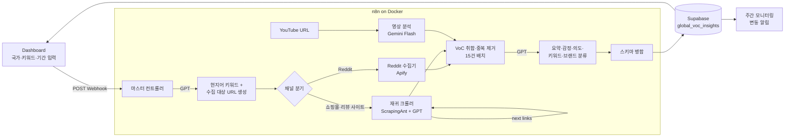

# Global VoC Research Agent

> 국가와 제품 키워드만 입력하면 현지 쇼핑몰·리뷰 사이트·커뮤니티·유튜브의 소비자 의견을 수집하고, 한국어 요약과 감정·의도·키워드·브랜드 분류까지 마친 데이터로 쌓는 AI 에이전트
> **n8n(Docker) 워크플로우 백엔드**, **외부 AI·수집 API 연동**, **인터랙티브 대시보드**로 구성

---

## 1. 배경

### 1.1 출발점
- LG전자 트롬 워시콤보(히트펌프 세탁건조기)의 **폴란드 런칭 전략**을 세우는 과정에서 시작
- 시장 전략의 근거로 현지 소비자의 실제 의견(VoC)이 필요했음
  - 수집 대상: 폴란드 가전 쇼핑몰, 가격비교·리뷰 사이트, 커뮤니티(Pepper.pl, Reddit), 유튜브 영상
- 그런데 분석을 시작하기도 전에, 수집 단계에서 시간과 비용이 대부분 소진됨

### 1.2 수집 과정에서 확인한 병목

| 구분 | 병목 | 실제 상황 |
|---|---|---|
| **ACCESS** | 해외 사이트 접속 제약 | 국내 IP로는 폴란드 커뮤니티와 가전 쇼핑몰 접속이 차단됨. 수집할 수 있었던 정보는 전체의 **10% 미만** |
| **LANGUAGE** | 번역과 맥락 해석 부담 | 현지어 검색어를 직접 찾아야 하고, 자막 없는 영상은 내용을 확인하기 어려움. 단순 번역으로는 현지 표현의 뉘앙스와 구매 의도를 파악하기 어려움 |
| **INTEGRATION** | 채널별 결과 분산 | 채널마다 데이터 형식이 달라 공통 기준으로 맞추고, 브랜드·제품별 비교를 위해 다시 취합하는 작업이 반복됨 |

- 기존 절차: 사이트 접속 → 개별 수집 → 번역·정리 → 분석 → 결과 통합
- 반복되는 비용: VPN 우회 비용, 번역 과정의 의미 손실, 수작업 취합

### 1.3 해결 방향

| 병목 | 해결 방식 | 구현 위치 |
|---|---|---|
| ACCESS | 대상 국가의 프록시와 헤드리스 브라우저로 접근 제한을 우회 | ScrapingAnt(`proxy_country`, residential) |
| LANGUAGE | 현지어 검색어를 자동 생성하고, 텍스트와 영상 음성을 한국어로 요약 | GPT(검색어 생성·분석), Gemini Flash(영상) |
| INTEGRATION | 모든 채널을 하나의 VoC 스키마로 정규화한 뒤 같은 기준으로 분류해 DB에 적재 | 수집 워크플로우별 정규화 → 배치 분석 → Supabase |

- **국가와 제품 키워드만 입력하면** 수집부터 요약·분석·대시보드까지 하나의 흐름으로 처리
  - 예: `PL` + `세탁건조기` → 현지어 검색어 `pralka z suszarką` → 현지 사이트 수집 → 한국어 인사이트
- 효과
  - VoC 확보 기간: 약 2주 → 약 10분
  - 국가 코드만 바꾸면 다른 거점 국가(US, KR, DE, UK 등)에 그대로 적용

### 1.4 에이전트 역할 구성

| 단계 | AI의 역할 | 사람이 하던 일 | 모델 |
|---|---|---|---|
| AI 01 · 탐색 | 현지 소비자가 쓰는 제품명으로 바꾸고, 현지 쇼핑몰·리뷰 사이트·Reddit 등 수집 대상을 구성 | 국가별 검색어를 알아보고 조사할 사이트를 직접 찾음 | GPT-4o-mini |
| AI 02 · 선별 | 페이지가 제품 상세·리뷰 / 제품 목록 / 무관한 페이지인지 판정하고, 리뷰를 추출하거나 다음 링크를 선택 | 사이트 안에서 제품 페이지와 리뷰 탭을 직접 찾아다님 | GPT-4o-mini |
| AI 03 · 분석 | 한국어 요약, 긍·부정 키워드, 감정, 글의 의도, 브랜드·제품 정보를 공통 기준으로 정리 | 번역하고 핵심 의견을 읽어 브랜드별로 분류·비교 | GPT-4o-mini |
| AI 04 · 영상 분석 | 자막 없이 영상의 음성과 화면을 분석해 영상 유형, 브랜드·모델명, 장점·불편 사항을 텍스트 VoC로 변환 | 현지어 영상을 직접 보고 기록·번역·요약 | Gemini Flash |

---

## 2. 시스템 구성



### 2.1 워크플로우 역할 분리

| 워크플로우 | 역할 | 주요 노드 |
|---|---|---|
| **시트 1** 마스터 컨트롤러 | 요청 수신 → 수집 대상 생성 → 채널별 수집기 호출 → 배치 분석 → DB 적재 | Webhook, LLM Chain, Switch, Execute Workflow, Split in Batches, Supabase |
| **시트 2** Reddit 수집기 | 게시글과 댓글을 한 번에 수집하고 VoC 스키마로 정규화 | HTTP Request(Apify), Code |
| **시트 3** 재귀 크롤러 | 검색 결과 → 목록 → 상품 → 리뷰 페이지를 리뷰가 나올 때까지 재귀 탐색 | HTTP Request(ScrapingAnt), LLM Chain, Execute Workflow(자기 호출) |
| **영상 분석** | 유튜브 영상의 음성·화면을 분석해 텍스트 VoC로 변환 | Gemini Flash |

- 채널별 수집기를 하위 워크플로우로 분리해서, 채널을 추가하거나 바꿀 때 마스터 로직을 고치지 않는 구조
- 모든 수집기는 같은 VoC 스키마로 반환하므로, 마스터 쪽에서는 채널을 구분하지 않고 취합

### 2.2 AI 모델 선택

| 용도 | 모델 | 설정 | 선택 이유 |
|---|---|---|---|
| 현지어 검색어·수집 대상 생성 | GPT-4o-mini | temperature 0.2 | 정해진 JSON 형식으로 사이트 목록을 안정적으로 반환 |
| 페이지 판정·리뷰 추출 | GPT-4o-mini | temperature **0.1** | 판정이 매번 같게 나와야 하므로 가장 낮게 설정 |
| VoC 분석·한국어 요약 | GPT-4o-mini | temperature 0.2 | 대량 배치 처리에서 비용 대비 분류 품질 확보 |
| 영상 분석 | **Gemini Flash** | | 아래 참고 |

- **영상만 Gemini Flash를 쓴 이유**
  - 현지 소비자 리뷰 영상은 자막이 없는 경우가 많음
  - 유튜브 자동 생성 자막(음성 인식)은 폴란드어 제품명·모델명을 정확하게 받아쓰지 못함
  - Gemini는 영상의 음성을 직접 인식하고 화면까지 함께 이해하므로, 자막을 거치지 않고 영상에서 바로 VoC를 뽑을 수 있음
  - 별도의 음성 인식(STT) 단계 없이 호출 한 번으로 끝나서 파이프라인이 단순해짐

---

## 3. 핵심 설계

### 3.1 재귀 크롤러: 끝나는 것이 보장되는 탐색
- **종료 조건**
  - `MAX_DEPTH = 6` 비상 브레이크
  - 방문 URL 집합(`visited`)을 재귀 호출에 넘겨 같은 페이지를 다시 방문하지 않음
  - 다음 링크가 없으면 `_noop` 아이템 하나를 반환해서 재귀 호출이 바로 끝남
- **검색 모드에 따른 확장 제한**
  - 키워드에 영문+숫자 토큰이 있으면 `MODEL`(모델 하나를 깊게), 아니면 `CATEGORY`(제품군을 넓게)
  - 모드마다 페이지당 다음 링크 수, 리뷰 페이지 홉 수의 상한이 다름

  | 모드 | 목록 링크 | 리뷰 링크 | 리뷰 홉 |
  |---|---|---|---|
  | MODEL | 3 | 3 | 5 |
  | CATEGORY | 10 | 1 | 2 |

- **페이지 판정**: LLM이 각 페이지를 `PRODUCT` / `LIST` / `IRRELEVANT`로 분류하고, 다음 행동(리뷰 추출 또는 하위 링크 선택)을 결정
  - CATEGORY 모드에서는 특정 브랜드에 치우치지 않도록 여러 브랜드 제품을 골고루, 리뷰 수가 많은 제품부터 선택

### 3.2 실패에 대비한 진입 경로
- 사이트마다 시작 경로를 3단계로 준비: **AI가 만든 사이트 검색 URL → 사이트 홈페이지 → DuckDuckGo `site:` 검색**
  - AI가 검색 URL 형식을 틀리게 만들어도(404, 빈 페이지) 다음 경로로 자동 전환
- 봇 차단·수집 실패는 같은 깊이에서 최대 2회 재시도하고, 그래도 실패하면 다음 대체 경로로 이동
- 재시도는 깊이를 늘리지 않아서 깊이 제한에 걸려 탐색이 끊기지 않음

### 3.3 LLM 환각 차단
- **링크는 코드가 뽑고 LLM은 번호만 고름**
  - 페이지의 링크를 코드로 추출·정규화한 뒤 번호를 붙여 LLM에 전달 (최대 200개)
  - 프롬프트에서 "목록에 없는 링크나 URL은 만들지 말 것"을 강제하고, 응답도 번호로만 받음
- **차단 페이지는 LLM에 넘기지 않음**
  - 캡차, Cloudflare 챌린지, 현지어 봇 차단 문구(폴란드어·독일어 포함)를 정규식으로 먼저 감지
  - 차단 페이지를 LLM에 주면 링크를 지어내는 현상을 확인하고 넣은 단계
- **노이즈 링크 사전 제거**: 로그인, 장바구니, 약관, SNS, 정적 리소스 링크를 미리 걸러 LLM 입력을 줄임
- **검색 결과 페이지는 LLM 없이 처리**: DuckDuckGo 결과는 리다이렉트 파라미터(`uddg`)를 코드로 디코딩해 링크만 추출하고, 광고 링크는 제외
- **수집 원문 보정**: ScrapingAnt 마크다운이 긴 URL 중간에 넣는 줄바꿈을 제거한 뒤 링크를 추출

### 3.4 데이터 계약과 파이프라인
- **공통 VoC 스키마**: 채널과 상관없이 `voc_id`, `source_site`, `content_type`(REVIEW/POST/COMMENT), `parent_id`, `published_at` 형식으로 통일
  - Reddit은 게시글과 댓글을 분리하고 `parent_id`로 연결
  - 날짜는 Unix timestamp와 문자열을 모두 `YYYY-MM-DD`로 변환
- **중복 제거**: 원본 ID(Reddit) 또는 콘텐츠 해시(쇼핑몰 리뷰)로 만든 `voc_id`로 수집기 결과를 합칠 때 중복 제거
- **배치 분석**: VoC를 15건 단위로 묶어 LLM에 전달해서 호출 수와 토큰 비용을 줄임
- **병합 시 원본 우선**: LLM 결과는 `voc_id`로 원본에 결합하고, 분석에 실패한 항목도 기본값을 넣어 원본은 버리지 않음
- **LLM 출력 방어 파싱**: 코드블록이나 설명문이 섞인 응답에서도 JSON 배열만 추출

### 3.5 저장 스키마 (`global_voc_insights`)

| 구분 | 필드 |
|---|---|
| 수집 메타 | `voc_id`, `country`, `keyword`, `source_site`, `category`, `content_type`, `parent_id`, `published_at` |
| 원문 | `content` |
| 제품 4단계 계층 | `product_category` → `target_brand` → `product_line` → `model_code` |
| 키워드 3분할 | `positive_keywords`, `negative_keywords`, `topic_tags` |
| 인사이트 | `kr_summary`, `ai_sentiment`, `user_intent`, `competitors` |
| 분석 메타 | `ai_metadata.lg_mentioned`, `ai_metadata.analyzed_at` |

- 제품 계층과 키워드 필드는 대시보드의 필터·집계 축과 1:1로 대응하도록 설계
- 분류값은 고정된 코드 체계를 사용
  - `ai_sentiment`: `POSITIVE` / `NEUTRAL` / `NEGATIVE`
  - `user_intent`: `EXPERIENCE`(후기) / `QUESTION`(구매 전 질문) / `COMPLAINT`(불만) / `COMPARISON`(비교) / `INFO`(정보 공유)
  - `target_brand`: 표준 영문 브랜드명, 여러 브랜드 비교 글은 `Comparison`, 특정할 수 없으면 `General`

---

## 4. API

### 4.1 구성

| 구분 | Method · Path | 호출 주체 | 처리 |
|---|---|---|---|
| 수집 실행 | `POST /webhook/voc-crawler-start` | 대시보드, 외부 스케줄러 | n8n 시트 1 |
| 출처 탐색 | `POST /webhook/discover-voc-sources` | 대시보드 | 출처 선택형 수집 1단계 |
| 선택 수집 | `POST /webhook/collect-selected-sources` | 대시보드 | 출처 선택형 수집 2단계 |
| 일괄 수집(CSV) | `POST /webhook/collect-global-voc` | 단건 스크립트, 내부 테스트 | 탐색부터 스크래핑까지 한 번에 실행하고 CSV 파일 반환 |

- 모든 요청은 `Content-Type: application/json`
- 대시보드의 엔드포인트 주소는 `config.js`와 설정 화면에서 바꿀 수 있어서 로컬·서버 환경을 코드 수정 없이 전환
- `server.js`는 출처 탐색·선택 수집과 같은 규격의 Mock 응답을 제공해서, 백엔드 없이도 프론트엔드를 개발·검증할 수 있음

### 4.2 수집 실행 `POST /webhook/voc-crawler-start`
수집부터 분석·DB 적재까지 전체 파이프라인을 실행

**Request**
```json
{
  "country": "PL",
  "keyword": "세탁건조기"
}
```

| 필드 | 타입 | 필수 | 설명 |
|---|---|---|---|
| `country` | string | 필수 | 국가명 또는 2자리 국가 코드. LLM이 표준 코드로 변환 (`Poland` → `PL`) |
| `keyword` | string | 필수 | 제품군 또는 모델명. 모델명(영문+숫자)이면 MODEL 모드, 아니면 CATEGORY 모드로 수집 |

**처리 순서**
1. GPT가 현지어 검색어와 수집 대상(현지 쇼핑몰·리뷰 사이트 5곳 이상 + Reddit 1곳)을 생성
2. URL 도메인으로 채널을 분기해서 Reddit 수집기 / 재귀 크롤러를 사이트별로 호출 (`waitForSubWorkflow: true`)
3. 수집된 VoC를 취합하고 중복을 제거한 뒤 15건씩 GPT로 분석
4. 원본과 분석 결과를 병합해 Supabase `global_voc_insights`에 저장

**Response** `200 OK`
- 동기 방식(`responseMode: lastNode`): 파이프라인이 끝나면 마지막 노드인 DB 저장 결과를 그대로 반환

```json
[
  {
    "voc_id": "1x7k2m",
    "country": "PL",
    "keyword": "세탁건조기",
    "source_site": "MediaExpert",
    "category": "E-commerce",
    "content_type": "REVIEW",
    "content": "[Brand: LG | Product: WashCombo | Model: WHX9516TBC | Rating: 5/5] ...",
    "parent_id": null,
    "published_at": "2026-09-14",
    "product_category": "세탁건조기",
    "target_brand": "LG",
    "product_line": "WashCombo",
    "model_code": "WHX9516TBC",
    "positive_keywords": ["건조성능", "공간활용"],
    "negative_keywords": ["가격"],
    "topic_tags": ["건조성능", "공간활용", "가격"],
    "kr_summary": "좁은 욕실에도 들어가고 건조가 잘 되지만 가격이 비싸다는 후기",
    "ai_sentiment": "POSITIVE",
    "user_intent": "EXPERIENCE",
    "competitors": ["Samsung"],
    "ai_metadata": { "lg_mentioned": true, "analyzed_at": "2026-11-19T12:00:00.000Z" }
  }
]
```

### 4.3 출처 탐색 `POST /webhook/discover-voc-sources`
수집하기 전에 후보 출처 목록을 받아서 사용자가 수집할 사이트를 고를 수 있게 함

**Request**
```json
{ "country": "PL", "product": "LG WashCombo" }
```

**Response** `200 OK`
```json
{
  "status": "success",
  "meta": { "country": "PL", "product": "LG WashCombo", "total_discovered": 2, "timestamp": "2026-11-19T12:00:00.000Z" },
  "sources": [
    {
      "source_id": "src_pl_mediaexpert_01",
      "site_name": "Media Expert",
      "category": "가전 판매점",
      "url": "https://www.mediaexpert.pl/...",
      "description": "폴란드 대표 가전 양판점 실구매 리뷰"
    },
    {
      "source_id": "src_pl_reddit_02",
      "site_name": "Reddit r/Polska",
      "category": "커뮤니티",
      "url": "https://www.reddit.com/search/?q=pralka%20z%20suszark%C4%85",
      "description": null
    }
  ]
}
```

| 필드 | 설명 |
|---|---|
| `source_id` | 2단계 요청에서 출처를 지정하는 식별자 |
| `category` | 출처 유형. 대시보드에서 유형 배지로 표시 |
| `description` | 한 줄 설명. 값이 없으면 `null`로 보내고, 대시보드는 임의로 채우지 않고 "사이트 설명 미확인"으로 표시 |

### 4.4 선택 수집 `POST /webhook/collect-selected-sources`
사용자가 고른 출처만 수집해서 CSV 파일로 반환

**Request**
```json
{
  "country": "PL",
  "product": "LG WashCombo",
  "selected_sources": [
    { "source_id": "src_pl_mediaexpert_01", "site_name": "Media Expert", "url": "https://www.mediaexpert.pl/..." }
  ]
}
```

**Response** `200 OK`
- `Content-Type: text/csv; charset=utf-8`
- `Content-Disposition: attachment; filename="scraped_voc_results.csv"`
- Excel에서 한글이 깨지지 않도록 UTF-8 BOM 포함

| 컬럼 | 설명 |
|---|---|
| `country`, `product` | 요청 값 |
| `site_name`, `source_url` | 출처 |
| `proxy_type`, `extraction_type` | 서버에서 적용한 수집 설정 |
| `status_code` | 대상 사이트의 HTTP 응답 코드 |
| `voc_content` | 수집한 원문 |

### 4.5 일괄 수집 `POST /webhook/collect-global-voc`
- 요청 `{ country, product }` 하나로 출처 탐색과 스크래핑을 연속 실행
- 결과는 `respondToWebhook` 노드에서 CSV 바이너리로 반환 (`Content-Disposition: attachment`)

### 4.6 서버에서만 관리하는 값
클라이언트는 다음 값을 보내지 않고, n8n 노드와 Credentials에서만 관리

| 값 | 위치 |
|---|---|
| 외부 API 키 (OpenAI, Gemini, ScrapingAnt, Apify, Supabase) | n8n Credentials |
| `proxy_type` (residential / datacenter) | ScrapingAnt 노드 |
| `extraction_type` (markdown) | ScrapingAnt 엔드포인트 |
| 국가 코드 예외 매핑 (`UK` → `GB`) | ScrapingAnt 노드 표현식 |

### 4.7 내부에서 호출하는 외부 API

| API | 호출 | 인증 | 주요 설정 |
|---|---|---|---|
| **OpenAI** | n8n LangChain Chat Model 노드 | Credentials | `gpt-4o-mini`, temperature 0.1~0.2 |
| **Gemini** | 영상 분석 워크플로우 | Credentials | Gemini Flash, 영상 URL + 분석 지시문 |
| **ScrapingAnt** | `GET https://api.scrapingant.com/v2/markdown` | Header `x-api-key` | `browser=true`, `proxy_country={국가}`, `proxy_type=residential`, 동시 요청 2개, 타임아웃 60초 |
| **Apify** | `POST https://api.apify.com/v2/acts/trudax~reddit-scraper-lite/run-sync-get-dataset-items` | Query `token` | 게시글 최대 5개, 게시글당 댓글 최대 15개, 최대 30건, 타임아웃 180초 |
| **Supabase** | n8n Supabase 노드 Insert | Credentials | 테이블 `global_voc_insights`, 입력 필드 자동 매핑 |

- ScrapingAnt는 결과를 마크다운으로 받아서 HTML 파싱 없이 LLM에 바로 넣을 수 있게 함
- Apify는 동기 실행 엔드포인트(`run-sync-get-dataset-items`)를 써서 별도 폴링 없이 한 번의 호출로 결과를 받음

### 4.8 오류 처리 규칙

| 상황 | 처리 |
|---|---|
| 수집 대상 생성 LLM이 JSON이 아닌 값을 반환 | 원본 응답을 포함한 오류로 즉시 중단. 잘못된 대상으로 수집 비용을 쓰지 않음 |
| 대상 사이트 봇 차단·캡차 | 같은 깊이에서 최대 2회 재시도 → 대체 경로(홈페이지 → DDG) |
| 검색 URL 오류(404, 빈 페이지) | 재시도 없이 바로 대체 경로로 이동 |
| 분석 LLM 응답 파싱 실패 | 해당 배치를 기본값으로 채우고 원본은 그대로 저장 |
| 하위 워크플로우 결과 없음 | 빈 결과로 취합해서 다른 채널 수집은 계속 진행 |

- 크롤링 경로(깊이, URL, 판정 유형, 리뷰 수, 재시도·대체 경로 여부)를 `_crawl_log`로 함께 반환해서 실행 결과에서 전체 탐색 경로를 추적할 수 있음

---

## 5. 대시보드

- **수집 화면**: 국가·키워드·기간을 입력하고 출처를 선택해서 수집 시작
- **결과 화면**: 사이트별 수집 내용, 브랜드·감정·의도별 집계와 키워드 분포
- **정기 모니터링**: 지정한 국가·주력 제품의 VoC를 매주 수집하고, 신규 VoC나 부정 이슈가 생겼을 때만 팀 채널로 변동 요약 알림
- **결과 내보내기**: 수집 결과 CSV와 출처 목록 CSV 다운로드, 브라우저에 이력 보관
- **진행 상태 표시**
  - `요청 전` / `요청 처리 중` / `응답 수신 완료` / `요청 실패` 4가지로만 표시 (가짜 진행률 없음)
  - HTTP 200 수신을 "리뷰 추출 성공"으로 단정하지 않고 "원문 수신됨"으로 구분
  - 응답에 없는 값은 추정하지 않고 `미확인`으로 표시

---

## 6. 보안

- **비밀 정보 격리**
  - 모든 외부 API 키는 n8n Credentials에 저장하고, 워크플로우 JSON에는 참조만 남김
  - 저장소, 프론트엔드 코드, 브라우저 스토리지, 요청 본문 어디에도 API 키를 두지 않음
  - 로컬 테스트 스크립트도 키를 환경변수(`SCRAPINGANT_API_KEY`)로만 읽음
- **XSS 방지**: 수집한 외부 텍스트는 이스케이프한 뒤 렌더링

---

## 7. 테스트와 검증

- **n8n 밖에서 같은 로직 실행**: `test-scrape.js`
  - 워크플로우 JSON에서 Code 노드 소스를 그대로 읽어 Node.js에서 실행
  - 워크플로우 전체를 돌리지 않고 특정 사이트의 수집·차단 감지·링크 추출 결과를 바로 확인
  ```bash
  export SCRAPINGANT_API_KEY="..."
  node test-scrape.js "https://www.mediaexpert.pl/" PL "pralka z suszarką"
  ```
- **노드 코드 분리 보관**: `sheet1-*.js`, `sheet3-*.js`에 Code 노드 로직을 따로 두어 diff와 리뷰가 가능하도록 관리
- **Mock API 서버**: `server.js`로 대시보드 연동 규격을 백엔드 없이 검증
  - 데모 모드 화면에는 `[시뮬레이션]` 라벨 표시

---

## 8. 기술 스택

| 영역 | 사용 기술 |
|---|---|
| 워크플로우 백엔드 | n8n (self-hosted, Docker) |
| AI | OpenAI GPT-4o-mini (검색어 생성·페이지 판정·분석), Google Gemini Flash (영상 분석) |
| 수집 | ScrapingAnt (헤드리스 브라우저 + 국가별 프록시), Apify Reddit Scraper, DuckDuckGo |
| 저장 | Supabase (PostgreSQL) |
| 대시보드 | Vanilla JS, Chart.js, Node.js 내장 `http` 서버 |
| 개발 도구 | Google Antigravity (AI 코딩 에이전트) |

---

## 9. 디렉터리 구조

```
.
├── [시트 1] 마스터 컨트롤러 ….json     # 오케스트레이션 + AI 배치 분석 + Supabase 적재
├── [시트 2] Reddit 전용 2-Depth 수집기 ….json
├── [시트 3] 재귀 크롤러 ….json
├── sheet1-master-controller.json       # 시트 1 이전 버전
├── sheet1-1depth-split.js              # Code 노드: 수집 대상 분리·대체 경로 구성
├── sheet3-input-prep.js                # Code 노드: 재귀 입력 정리·검색 모드 판정
├── sheet3-page-prep.js                 # Code 노드: 페이지 정리·차단 감지·링크 추출
├── sheet3-result.js                    # Code 노드: 판정 결과 → 리뷰 / 다음 링크 / 재시도
├── test-scrape.js                      # n8n 없이 시트 3 로직을 실행하는 테스트 하네스
└── global-voc-agent/
    ├── 01-architecture-and-api-spec.md # 대시보드 연동 API 규격서
    ├── global_voc_scraper_workflow.json# 일괄 수집(CSV) 워크플로우
    ├── server.js                       # 대시보드 정적 서빙 + Mock API
    └── dashboard/                      # 수집 → 결과 조회 → 정기 모니터링 UI
```

---

## 10. 실행 방법

### 10.1 n8n 실행 (Docker)
```bash
docker volume create n8n_data
docker run -d --name n8n -p 5678:5678 \
  -v n8n_data:/home/node/.n8n \
  -e GENERIC_TIMEZONE=Asia/Seoul \
  n8nio/n8n
```
- `http://localhost:5678` 접속 → 워크플로우 JSON을 **Import from File**
- Credentials 등록
  - OpenAI, Google Gemini
  - ScrapingAnt: Header Auth (`x-api-key`)
  - Apify: Query Auth (`token`)
  - Supabase
- 시트 1의 Execute Workflow 노드가 시트 2·3을 가리키는지 확인
- 볼륨(`n8n_data`)에 워크플로우와 Credentials가 저장되어 컨테이너를 다시 만들어도 유지됨

### 10.2 수집 실행
```bash
curl -X POST http://localhost:5678/webhook/voc-crawler-start \
  -H "Content-Type: application/json" \
  -d '{"country": "PL", "keyword": "세탁건조기"}'
```

### 10.3 대시보드
```bash
cd global-voc-agent
node server.js        # http://localhost:3005
```
- 외부 패키지 없이 Node.js 내장 모듈로 실행
- 설정 화면에서 n8n Webhook 주소를 지정하면 실제 모드로 동작

### 10.4 로컬 테스트
- `test-scrape.js`는 시트 3 워크플로우를 `sheet3-recursive-crawler.json` 이름으로 읽음
- `[시트 3] 재귀 크롤러 ….json`을 이 이름으로 복사한 뒤 실행
