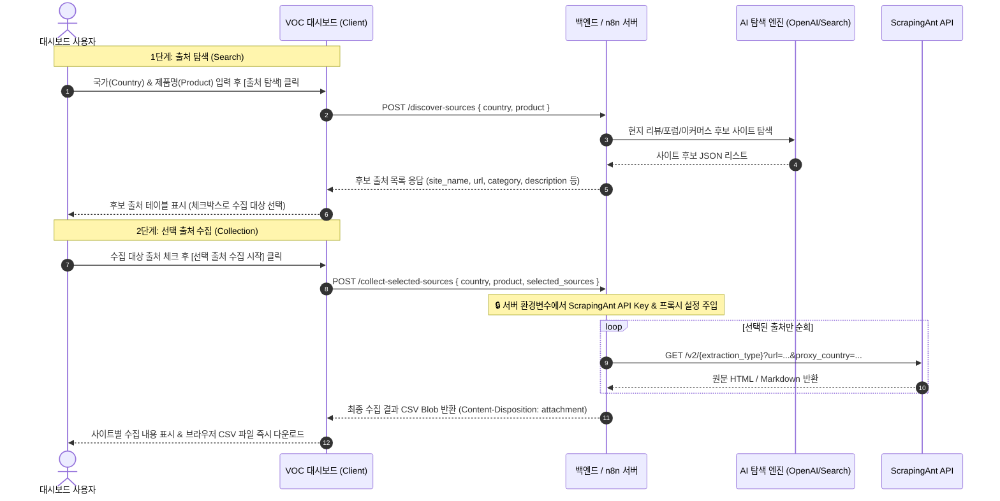

# 01-architecture-and-api-spec.md: 글로벌 VOC 수집기 API 규격 및 팀 연동 가이드

> **문서 버전**: v1.0.0 (출처 선택형 분리 및 보안 아키텍처 개정)  
> **대상자**: 프론트엔드 엔지니어, 백엔드/n8n 워크플로우 엔지니어  
> **상태**: 🟡 백엔드 API 분리 및 필터링 기능 구현 대기 중 (인터페이스 합의안)

---

## 1. 아키텍처 개요 및 전환 배경

### 1.1 현재 워크플로우의 동작 한계 (`global_voc_scraper_workflow.json`)
현재 구현된 워크플로우는 **단일 Webhook(`POST /collect-global-voc`)**을 통해 다음 과정을 일괄(One-Stop) 처리하고 있습니다:
1. Webhook 트리거로 `country`, `product`, `proxy_type`, `extraction_type`, `api_key` 수신
2. OpenAI `gpt-4o-mini` 모델이 후보 사이트 목록(5~10개) JSON 생성
3. 중간 CSV 파일(`target_sites.csv`) 생성 및 로컬 저장
4. Python 스크래퍼가 모든 후보 사이트를 ScrapingAnt API로 순회 스크래핑
5. 최종 결과 CSV(`scraped_voc_results.csv`) 바이너리 파일 반환

#### ⚠️ 문제점
* 사용자가 **수집 대상 사이트를 선별하거나 불필요한 출처를 제외할 수 없습니다.**
* ScrapingAnt API 호출 크레딧이 의도치 않은 비관련 사이트에 소모됩니다.
* 단일 요청이 완료될 때까지(수십 초~수 분) 실시간 상태를 조회할 수 없습니다.
* **보안 위험**: `api_key`(ScrapingAnt API 키)를 클라이언트로부터 전달받도록 설계되어 있어 프론트엔드 노출 위험이 존재합니다.

---

### 1.2 목표 아키텍처 (2단계 분리 구조)

대시보드와 백엔드는 아래와 같이 **[1단계: 출처 탐색]**과 **[2단계: 선택 출처 수집]**으로 명확히 역할을 분리합니다.



---

## 2. API 엔드포인트 세부 규격 (팀원 합의 예정안)

> ⚠️ **주의**: 아래 규격은 **대시보드와 백엔드가 연동하기 위해 합의 예정인 인터페이스**입니다.  
> 현재 워크플로우에 존재하는 단일 Webhook(`collect-global-voc`)과 구분되며, 백엔드 팀원이 2개의 독립 엔드포인트로 분리 구현해야 합니다.

### 2.1 [엔드포인트 1] 후보 출처 탐색 (`discoverSources`)

사용자가 지정한 국가와 제품군에 맞는 수집 후보지 목록을 탐색하여 반환합니다.

* **Method**: `POST`
* **Path**: `/api/voc/discover-sources` (n8n Webhook: `/webhook/discover-voc-sources`)
* **Headers**: `Content-Type: application/json`

#### 요청 본문 (Request Body)
```json
{
  "country": "US",
  "product": "OLED TV G4"
}
```

#### 필드 정의 (Request)
| 필드명 | 타입 | 필수 여부 | 설명 | 예시 |
| :--- | :--- | :---: | :--- | :--- |
| `country` | string | **필수** | ISO 3166-1 alpha-2 국가 코드 | `"US"`, `"JP"`, `"DE"`, `"PL"` |
| `product` | string | **필수** | 조사를 원하는 구체적인 타겟 제품명 | `"CordZero A9X"`, `"OLED TV"` |

#### 응답 본문 (Response Body - 200 OK)
```json
{
  "status": "success",
  "meta": {
    "country": "US",
    "product": "OLED TV G4",
    "total_discovered": 4,
    "search_engine": "llm_candidate_generator",
    "timestamp": "2026-10-23T12:00:00Z"
  },
  "sources": [
    {
      "source_id": "src_us_bestbuy_01",
      "site_name": "Best Buy US",
      "url": "https://www.bestbuy.com/site/reviews/oled-tv-g4",
      "category": "E-Commerce",
      "description": "북미 대표 전자제품 리테일 실사용자 리뷰",
      "product_match": "확인",
      "review_status": "확인",
      "review_count": "1,420건"
    },
    {
      "source_id": "src_us_reddit_02",
      "site_name": "Reddit r/OLED",
      "url": "https://www.reddit.com/r/OLED/comments/g4_review",
      "category": "Community/Forum",
      "description": "실제 게이머 및 테크 유저 번인/화질 실사용 평가",
      "product_match": "확인",
      "review_status": "확인",
      "review_count": "340건"
    },
    {
      "source_id": "src_us_rtings_03",
      "site_name": "RTINGS.com",
      "url": "https://www.rtings.com/tv/reviews/lg/g4-oled",
      "category": "Professional Review",
      "description": "전문가 랩테스트 측정치 및 사용자 코멘트",
      "product_match": "확인",
      "review_status": "확인",
      "review_count": "85건"
    },
    {
      "source_id": "src_us_avsforum_04",
      "site_name": "AVS Forum",
      "url": "https://www.avsforum.com/threads/2026-lg-g4-series-thread",
      "category": "Tech Community",
      "description": null,
      "product_match": null,
      "review_status": null,
      "review_count": null
    }
  ]
}
```

#### 출처 데이터 필드 명세 & 대시보드 표시 규칙
| 필드명 | 현재 워크플로우 지원 | 확장 필드 (신규) | 대시보드 표시 규칙 |
| :--- | :---: | :---: | :--- |
| `site_name` | ✅ 지원 | - | 출처 사이트 이름 (굵은 글씨) |
| `url` | ✅ 지원 | - | 대상 원본 URL (외부 링크 아이콘 및 새창 열기) |
| `category` | ✅ 지원 | - | 사이트명 옆 **유형 배지**(`badge`)로 시각화 (예: `E-Commerce`, `Community`) |
| `source_id` | ❌ 미지원 | ➕ 추가 | 각 출처의 고유 식별자 (없을 경우 URL 해시/인덱스로 대체) |
| `description` | ❌ 미지원 | ➕ 추가 | 한 줄 요약 설명. **누락(null) 시 '사이트 설명 미확인'으로 표시** (임의 날조 금지) |
| `product_match` | ❌ 미지원 | ➕ 추가 | 제품 일치 여부. **응답에 없으면 '미확인'으로 표시** |
| `review_status` | ❌ 미지원 | ➕ 추가 | 리뷰 존재 여부. **응답에 없으면 '미확인'으로 표시** |
| `review_count` | ❌ 미지원 | ➕ 추가 | 확인된 리뷰 수. **응답에 없으면 '미확인'으로 표시** |

> 📌 **Google 검색 연동 표기 규칙**:  
> 현재 n8n 워크플로우의 탐색 노드는 OpenAI 프롬프트 기반 후보지 생성이며 실제 Google 검색 API(SERP)와 연결되어 있지 않습니다.  
> 따라서 백엔드에서 실제 검색 연동이 확인되기 전까지 대시보드에서는 'Google 검색 결과'라는 표현을 쓰지 않고 **'후보 출처'**로 표기합니다.

---

### 2.2 [엔드포인트 2] 선택 출처 수집 실행 (`collectSelectedSources`)

사용자가 1단계에서 체크박스로 선택한 출처들만 선별하여 ScrapingAnt로 스크래핑을 수행하고 결과 CSV 파일을 반환합니다.

* **Method**: `POST`
* **Path**: `/api/voc/collect-selected-sources` (n8n Webhook: `/webhook/collect-selected-sources`)
* **Headers**: `Content-Type: application/json`
* **Response**: Binary CSV Attachment (`text/csv` / `application/octet-stream`)

#### 요청 본문 (Request Body)
```json
{
  "country": "US",
  "product": "OLED TV G4",
  "selected_sources": [
    {
      "source_id": "src_us_bestbuy_01",
      "url": "https://www.bestbuy.com/site/reviews/oled-tv-g4",
      "site_name": "Best Buy US"
    },
    {
      "source_id": "src_us_reddit_02",
      "url": "https://www.reddit.com/r/OLED/comments/g4_review",
      "site_name": "Reddit r/OLED"
    }
  ]
}
```

#### 필드 정의 (Request)
| 필드명 | 타입 | 필수 여부 | 설명 |
| :--- | :--- | :---: | :--- |
| `country` | string | **필수** | 수집 대상 국가 코드 (ScrapingAnt `proxy_country`로 전달) |
| `product` | string | **필수** | 수집 기준 제품명 |
| `selected_sources` | array | **필수** | 사용자가 선택한 출처 목록 (최소 1개 이상). URL과 사이트명 포함 |

#### 서버 측 격리 설정 (Client 전송 금지 파라미터)
아래 파라미터는 프론트엔드가 전송하지 않으며, **백엔드 서버 또는 n8n 워크플로우 설정**에서 주입/관리합니다:
* `api_key`: ScrapingAnt API Key (서버 환경변수 `SCRAPINGANT_API_KEY`로 주입)
* `proxy_type`: `"datacenter"` 또는 `"residential"` (서버 기본값 또는 프리셋 관리)
* `extraction_type`: `"markdown"` (기본값) 또는 `"extract"` / `"extended"`
* `extract_properties`: `"reviews(list: author, rating, date, review_title, review_text)"`

#### 응답 헤더 및 바디 (200 OK)
* **Headers**:
  ```http
  Content-Type: text/csv; charset=utf-8
  Content-Disposition: attachment; filename="scraped_voc_results.csv"
  ```
* **Body**: CSV 텍스트 스트림 (UTF-8)

---

## 3. 결과 CSV 데이터 스키마 & 대시보드 렌더링 규칙

### 3.1 현재 CSV 파일 컬럼 구성
워크플로우가 생성하는 최종 CSV 컬럼은 다음과 같습니다:

| 컬럼명 | 샘플 데이터 | 설명 | 대시보드 표시 위치 |
| :--- | :--- | :--- | :--- |
| `country` | `US` | 수집 국가 | 출처·처리 결과 탭 |
| `product` | `OLED TV G4` | 타겟 제품명 | 헤더 및 결과 메타데이터 |
| `site_name` | `Best Buy US` | 출처 사이트 이름 | 카드 헤더 및 요약 테이블 |
| `source_url` | `https://www.bestbuy.com/...` | 수집 대상 URL | 클릭 가능한 안전 링크 |
| `proxy_type` | `datacenter` | 프록시 유형 | 출처·처리 결과 탭 (메타 배지) |
| `extraction_type` | `markdown` | 추출 유형 | 출처·처리 결과 탭 (메타 배지) |
| `status_code` | `200` | HTTP 응답 상태 코드 | 상태 뱃지 (200=초록, 4xx/5xx=빨강) |
| `voc_content` | `## Customer Reviews\nGreat picture...` | 스크래핑된 원문 콘텐츠 | 사이트별 수집 내용 (접이식/상세 패널) |

### 3.2 대시보드 표시 원칙 및 금지 사항
1. **사이트 단위 수집 결과 뷰**:
   * 현재 백엔드는 "리뷰 1건 단위(작성자, 평점, 날짜 등)"의 구조화 데이터를 제공하지 않고, **사이트 1곳당 1행의 수집 결과(`voc_content`)**를 제공합니다.
   * 따라서 결과 화면은 `사이트별 수집 내용`과 `출처·처리 결과` 2개 탭으로 분리하여 제공합니다.
2. **평점/날짜/작성자 임의 표기 절대 금지**:
   * 별도 구조화 파싱 API가 제공되기 전까지는 별점(★), 작성일, 개별 리뷰 개수, 구매 인증 뱃지를 허위로 만들어 표시하지 않습니다.
3. **HTTP 200 해석 주의**:
   * `status_code: 200`은 **웹페이지 HTTP 응답을 정상적으로 수신했음**을 의미할 뿐, **리뷰 텍스트가 정상 추출되었음**을 보증하지 않습니다 (예: 봇 차단 페이지를 200으로 반환하는 경우).
   * 따라서 대시보드에서는 "리뷰 추출 성공" 대신 **"HTTP 200 수신 (내용 분석 대기 / 원문 수신됨)"**으로 정확히 표기합니다.
4. **외부 HTML XSS 보안 새니타이징**:
   * 외부 수집 콘텐츠에 포함된 `<script>`, `<iframe>` 등이 브라우저에서 실행되지 않도록 모든 `voc_content`는 HTML 이스케이프(Escape) 처리 후 안전 텍스트 뷰어로 렌더링합니다.

---

## 4. 진행 상태 표시 규칙

| 상태 구분 | 상태 라벨 | 설명 |
| :--- | :--- | :--- |
| 1단계 | `요청 전` | 국가/제품 입력 및 출처 선택 완료, 수집 대기 중 |
| 2단계 | `요청 처리 중` | 백엔드로 선택 출처 수집 요청을 전송하고 응답 대기 중 |
| 3단계 | `응답 수신 완료` | 백엔드로부터 결과 CSV Blob을 수신하여 렌더링 완료 |
| 4단계 | `요청 실패` | 네트워크 오류 또는 백엔드 5xx 에러 발생 |

* **금지 사항**:
  * 실시간 소켓/폴링 API가 없으므로 **임의의 진행률(퍼센트, 예: 65%)**, **임의의 "현재 수집 중인 사이트명"**, **가짜 남은 시간 카운트다운**을 절대 표시하지 않습니다.
* **데모 모드 표기**:
  * 데모 모드에서 단계별 시연을 보여주는 경우, 모든 프로그레스 및 상태창에 **`[시뮬레이션]`** 라벨을 부착하여 실제 백엔드 상태가 아님을 명시합니다.

---

## 5. 백엔드 팀원 추가 구현 요구사항 목록 (Handover Checklist)

백엔드 엔지니어는 다음 순서에 따라 n8n 워크플로우를 고도화해 주셔야 합니다:

- [ ] **1. Webhook 2개 분리**:
  - `POST /webhook/discover-voc-sources`: AI 후보 탐색 노드(Node 2, 3)까지만 실행 후 사이트 JSON 배열 반환
  - `POST /webhook/collect-selected-sources`: `selected_sources` 배열을 받아 Node 7(Python 스크래퍼) 및 Node 8, 10 실행
- [ ] **2. Python 스크래퍼 입력 연동**:
  - 현재 워크플로우의 Node 6(전체 CSV 로드) 대신, Webhook 요청 본문의 `selected_sources` 목록만 순회하도록 파이썬 코드 수정
- [ ] **3. ScrapingAnt 보안 키 환경변수 격리**:
  - Webhook 요청 본문에서 `api_key`를 받지 않고, n8n Credentials 또는 워크플로우 Environment Variable(`$env.SCRAPINGANT_API_KEY`)로 고정
- [ ] **4. (선택/추후) 비동기 Job ID 및 상태 조회 API**:
  - 긴 스크래핑 시간을 감안하여 `POST /collect-selected-sources` 시 즉시 `job_id`를 반환하고, `GET /api/voc/jobs/{job_id}/status`로 세부 진행률 및 완료 여부를 조회할 수 있도록 개선
- [ ] **5. (선택/추후) 리뷰 단위 정형화 추출 노드 추가**:
  - ScrapingAnt 추출 결과를 파싱하여 `[ { author, rating, date, review_title, review_text } ]` 구조화 JSON을 반환하는 노드 추가 시 대시보드 2단계 고도화 진행 예정
